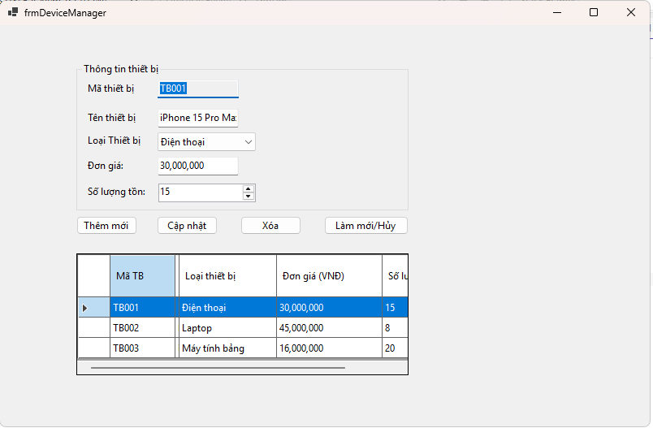
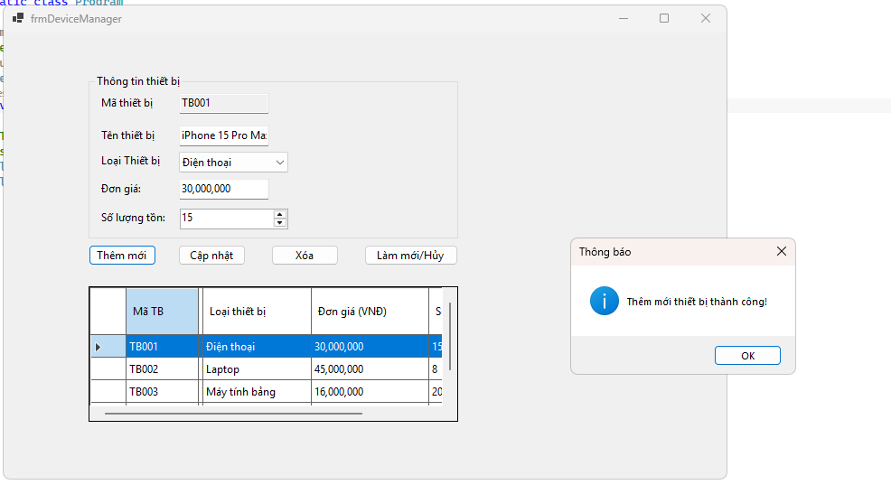
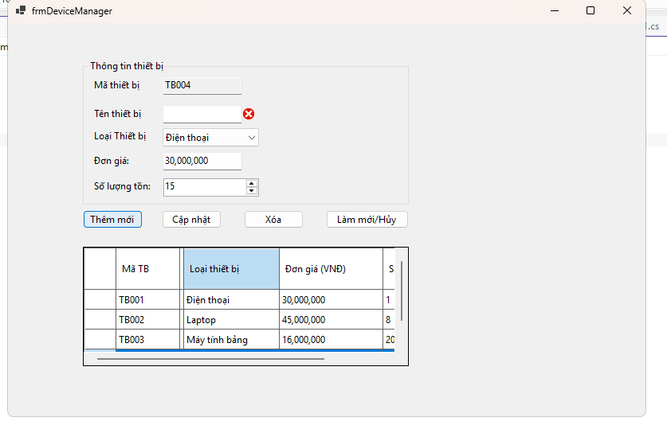
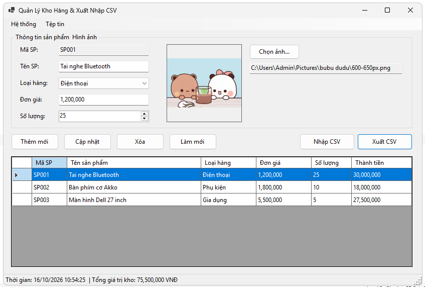
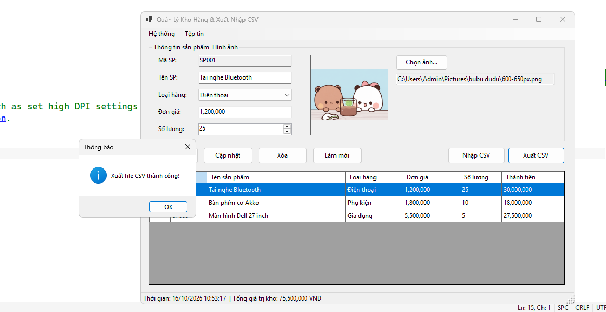
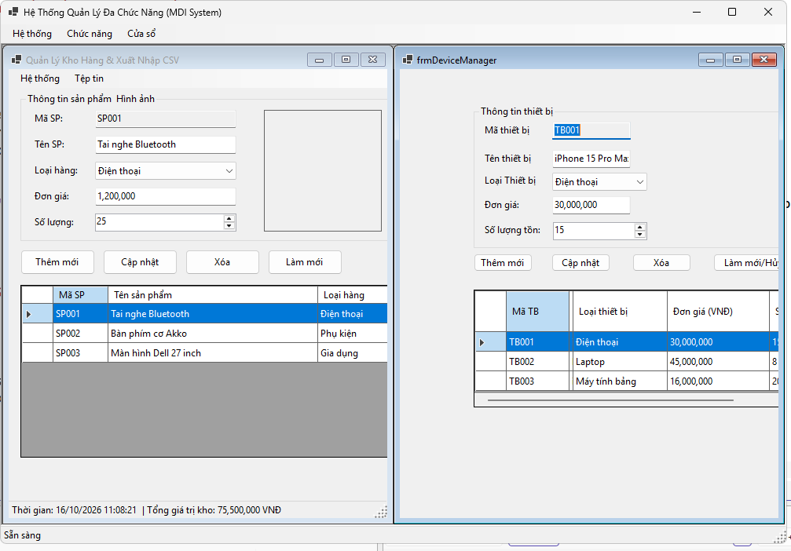
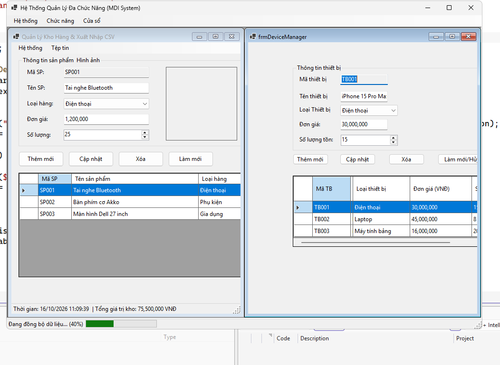

# BÀI TẬP LẬP TRÌNH C# - WINDOWS FORMS

## 1. Thông tin sinh viên

- Họ và tên: Lại Thanh Long
- Mã sinh viên: 24810310231
- Lớp: D19CNPM3
- Môn học: Lập trình C# / Windows Forms
- Tên bài tập: Ôn tập Windows Forms

## 2. Mô tả

Project được xây dựng bằng C# và Windows Forms trên Visual Studio.

## 3. Ảnh minh họa

Các ảnh minh họa sẽ được lưu trong thư mục `screenshots`.

### Giao diện chính Bài 1

### Kết quả thực thi

### Kiểm tra lỗi

### Quản lý kho hàng (Bài 2)

### Xuất / Nhập CSV (Bài 2)

S

### Hệ thống MDI Parent (Bài 3)

### Đồng bộ dữ liệu Async (Bài 3)

